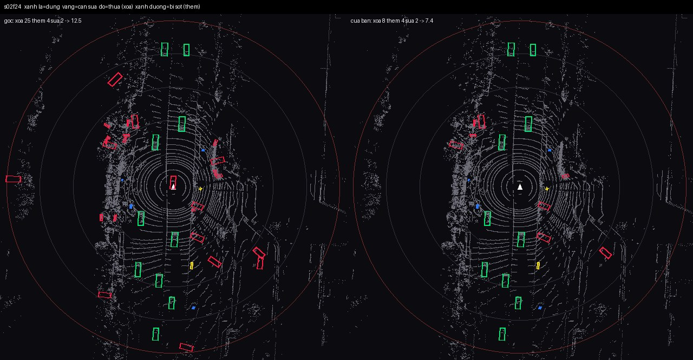

# Báo cáo Day 14 — Lê Vĩnh Khải — 2A202603322

- Mã học viên dùng với `--student`: `2A202603322`
- `seed_tag` trong `frames_A.txt`: `82ac3100fd`

## 1. Dự đoán trước sweep (bước 5b)

Ghi **trước** khi chạy `scripts/pp_sweep.py`, rồi commit và push ngay (lịch sử commit là bằng chứng thời điểm viết). Không sửa phần này sau khi có kết quả.

- Tham số tôi nghĩ giảm công sửa nhiều nhất: tăng `score_thr`.
- Vì sao (nhìn ảnh BEV tập A: box thừa nhiều hay box sót nhiều?): trên tập A, box thừa khá nhiều và phải xóa tay rất nhiều (cấu hình gốc: xóa 48, thêm 16, sửa 7, chi phí 33.9). Box thừa chủ yếu nằm ở các hàng rào cây, bụi cây bên đường và bị model nhận nhầm thành Car hoặc Cyclist: ở những chỗ điểm LiDAR dày, model dễ đoán đó là vật thể. Các box thừa này thường có độ tin cậy thấp (trung vị score khoảng 0.35, trong khi box giữ lại có trung vị khoảng 0.88). Vì vậy khi tăng `score_thr`, các box có score thấp sẽ bị loại, từ đó bớt được box thừa và giảm số box phải xóa tay.

## 2. Tập A: sửa tay và tune

| Cấu hình | Xóa | Thêm | Sửa | Chi phí |
|---|---:|---:|---:|---:|
| Gốc | 48 | 16 | 7 | 33.9 |
| `best_config.json` | 18 | 17 | 7 | 25.9 |

- Tham số đã đổi trong `best_config.json`: `score_thr` 0.1 → 0.4; `min_points` giữ 0 (các tham số khác giữ mặc định). Chi phí tập A giảm 33.9 → 25.9 (khoảng 24%).
- Kết quả leave-one-out (dán các dòng `scripts/pp_sweep.py` in ra):

  ```
  s01f49: cấu hình chọn {'score_thr': 0.4, 'min_points': 0} → 12.1 (tốt nhất có thể 12.1)
  s02f24: cấu hình chọn {'score_thr': 0.4, 'min_points': 0} → 7.4 (tốt nhất có thể 7.4)
  s04f19: cấu hình chọn {'score_thr': 0.4, 'min_points': 0} → 6.4 (tốt nhất có thể 6.4)
  ```
- Cấu hình có ổn định trên từng frame không? Vì sao tôi vẫn chọn (hoặc không chọn) nó: ổn định trên 3 frame tập A. Khi bỏ ra từng frame, cấu hình chọn trên 2 frame còn lại vẫn là `score_thr=0.4, min_points=0` và đạt đúng chi phí tốt nhất có thể trên frame bị bỏ ra. Tôi chọn cấu hình này vì nó cân bằng giữa xóa và thêm: so với gốc, số box phải xóa giảm 48 → 18 nhưng chỉ mất thêm 1 box đúng (thêm 16 → 17). Tăng tiếp lên 0.5 thì xóa còn 8 nhưng sót tăng lên 23, nên chi phí lại tăng (26.9) vì mỗi box sót tốn 1.0 so với 0.3 khi xóa. `min_points` gần như không có tác dụng: ở `score_thr=0.4` cả 0, 5, 10 cho cùng kết quả. Giới hạn: chỉ có 3 frame; riêng s04f19 có chi phí 6.4 ở mọi cấu hình nên frame này không giúp phân biệt các cấu hình, kết luận chủ yếu dựa trên 2 frame còn lại.

## 3. Trước/sau (bước 8)



*Frame s02f24, trái: cấu hình gốc (xóa 25, thêm 4, sửa 2 → 12.5); phải: `best_config.json` (xóa 8, thêm 4, sửa 2 → 7.4). Xanh lá = đúng, vàng = cần sửa, đỏ = thừa, xanh dương = bị sót.*

- `scripts/pp_compare.py` báo giảm 24% công sửa trên tập A (33.9 → 25.9). Theo frame: s01f49 15.0 → 12.1, s02f24 12.5 → 7.4, s04f19 6.4 → 6.4.
- Dự đoán ở mục 1 đúng hay sai? Giải thích bằng số box xóa/thêm/sửa: dự đoán **đúng**. Tăng `score_thr` từ 0.1 lên 0.4 đã loại được phần lớn box thừa có score thấp: số box phải xóa giảm từ 48 xuống 18 (−30 box, tương đương −9.0 điểm). Đổi lại có 1 box đúng bị lọc mất nên số box phải thêm tăng từ 16 lên 17 (+1.0 điểm); số box phải sửa giữ nguyên 7. Tổng chi phí giảm từ 33.9 xuống 25.9 (−8.0, khoảng 24%). Rõ nhất ở frame s02f24 (ảnh trên): số box xóa giảm từ 25 xuống 8, thêm và sửa không đổi, chi phí 12.5 → 7.4; s01f49 giảm 15.0 → 12.1; riêng s04f19 giữ nguyên 6.4 vì frame này ít box thừa.

## 4. Tập B

Số đo từ `scripts/pp_prelabel.py --frames d14_2A202603322/frames_B.txt --config d14_2A202603322/best_config.json --gt d14_2A202603322/ref_B.json`:

| Xóa | Thêm | Sửa | Chi phí |
|---:|---:|---:|---:|
| 86 | 36 | 18 | 70.8 |

(12 frame, GT 147 box trong 50 m, dự đoán 197, khớp 111. Đóng góp vào chi phí: thêm 36.0, xóa 25.8, sửa 9.0.)

- Loại box tốn công sửa nhất ở tập B: **box bị sót** (36 box, 36.0 trên 70.8 điểm, khoảng 51%). Đó chủ yếu là người đi bộ, người lái xe máy, xe ở xa ít điểm LiDAR, xe van và xe buýt bị hàng cây che. Box thừa nhiều nhất về số lượng (86 box, 25.8 điểm), chủ yếu nằm trên hàng cây, bụi cây, bãi xe đạp hoặc xe máy dựng, và một box trùm lên chính xe ego ở nhiều frame; ngưỡng `score_thr=0.4` chưa lọc hết vì nhiều box thừa có score 0.4–0.6. 18 box phải sửa (9.0 điểm), phần lớn là sai lớp: model KITTI không có Truck/Bus nên xe tải, xe ben, xe buýt đều bị gán Car. Tính trung bình, tập B tốn khoảng 5.9 điểm/frame (70.8 / 12), thấp hơn tập A sau tune (25.9 / 3 ≈ 8.6 điểm/frame), nhưng hai tập khác frame nên không so trực tiếp được.

## 5. Giới hạn

- Chỉ có 3 frame để tune: leave-one-out ổn định nhưng mẫu quá nhỏ; riêng s04f19 có chi phí như nhau ở mọi cấu hình nên không giúp phân biệt.
- Model học trên KITTI (LiDAR 64 tia, chỉ phía trước, 3 lớp): không có lớp Truck/Bus, hay bỏ sót người đi bộ và người lái xe máy, và hay nhận nhầm hàng cây, bụi cây thành Car/Cyclist.
- Chi phí là công thức do lab đặt (0.3·xóa + 1.0·thêm + 0.5·sửa), chưa phải thời gian sửa thật; không nên quy đổi thành "tiết kiệm X giờ công".
- Nhãn tham chiếu do một người sửa: vật ở xa, thưa điểm hoặc bị cây che (đặc biệt các xe buýt sau hàng cây ở s03f54 và vài xe cách 39–48 m) có thể còn sai; chỉ xét trong 50 m.
- Chỉ tune `score_thr` và `min_points`; chưa thử ngưỡng riêng theo lớp (`thr_car`, `thr_cyc`, `thr_ped`), có thể giảm box thừa Cyclist mà ít mất người đi bộ hơn.
- Khai báo: tôi có dùng AI (Claude) hỗ trợ rà soát, sau đó tôi tự review và chỉnh lại.
